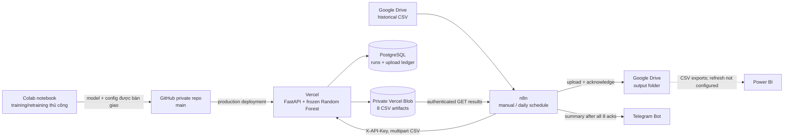

# Chương 7 — Hồ sơ bằng chứng kỹ thuật

**Dự án:** Eucerin ML Automation — dự báo xác suất phát sinh bán theo SKU TikTok Shop  
**Ngày kiểm kê:** 19/11/2026 (Asia/Ho_Chi_Minh)  
**Mục đích:** Tổng hợp bằng chứng kỹ thuật để biên soạn Chương 7. Đây là hồ sơ triển khai và kiểm chứng, không phải toàn văn chương báo cáo học thuật.

## Phạm vi và cách đọc bằng chứng

Tài liệu phân biệt ba nguồn: (1) source code/cấu hình trong repository; (2) kết quả kiểm thử và báo cáo đã lưu trong repository; (3) ảnh/output n8n và Google Drive do chủ dự án cung cấp trong cuộc trao đổi ngày 19/11/2026. Repository không chứa execution log n8n hoặc ảnh chụp màn hình. Vì vậy, kết quả dịch vụ Drive/Telegram bên dưới được ghi là bằng chứng từ giao diện/output người dùng cung cấp, không phải log có thể tái chạy từ repo.

Không đọc hoặc sao chép giá trị `.env`, API key, Telegram token, mật khẩu hay connection string. Không gọi production API trong lúc lập tài liệu. Không sửa source code, cấu hình triển khai hoặc workflow; không commit/push.

## 1. Tổng quan kiến trúc triển khai

Repository riêng `kl3485058-jpg/eucerin-ml-automation`, nhánh `main`, là nguồn mã cho ứng dụng. Notebook Chương 6 đã tạo model và cấu hình; Vercel triển khai FastAPI inference. n8n điều phối đọc CSV từ Google Drive, gọi Vercel, lấy tám CSV kết quả, tải chúng lên Drive, xác nhận từng file với API và gửi tóm tắt Telegram. PostgreSQL lưu trạng thái bền vững trên Vercel; Vercel Blob lưu artifact riêng tư. Power BI có thể đọc các CSV tương thích, nhưng workspace, semantic model và refresh chưa được cấu hình/chứng minh.

**Luồng dữ liệu:** CSV lịch sử đầy đủ → n8n → `POST /predict-file` → kiểm tra dữ liệu → nạp model cố định và dự báo T+1..T+7 → tạo tám CSV → Vercel Blob → n8n tải từng file → Drive upload → API acknowledge đủ tám file → API reserve thông báo → Telegram → API đánh dấu delivered.

GitHub và Vercel là phần triển khai đã có bằng chứng trong repo. Render còn các tệp cấu hình/hướng dẫn cũ, nhưng không phải đích production hiện tại. Colab dùng để train/retrain riêng, không phải worker trong workflow chạy hằng ngày. Mã hiện tại không gọi trực tiếp TikTok Shop/FastMoss API; đầu vào là CSV do người vận hành đưa vào Drive.

## 2. Cấu trúc dự án và triển khai FastAPI trên Vercel

| Thành phần | Vai trò và bằng chứng |
|---|---|
| `app/main.py` | Khởi tạo FastAPI `app`, auth API, endpoints, inference, export, run state và Telegram lifecycle. |
| `app/data_validation.py` | Kiểm tra CSV và giới hạn đầu vào: 4 MiB trên Vercel, 20 MiB local/Render. |
| `app/forecast.py`, `app/features.py`, `app/chapter6_pipeline.py` | Nạp model đã đóng gói, xác minh feature contract, tạo feature inference và xác suất. |
| `app/reporting.py`, `app/segmentation.py` | Tạo tám CSV, summary và text Telegram; phân nhóm ADI/CV². |
| `app/store.py` | PostgreSQL khi `VERCEL=1`; SQLite khi local/Render. Trên Vercel, `/tmp/eucerin` chỉ là vùng làm việc tạm. |
| `models/Model_Classification.joblib`, `models/Model_Config.json` | Model pipeline và cấu hình/feature contract đã đóng băng. Model file trong báo cáo API có kích thước 3.613.442 byte. |
| `vercel.json`, `.python-version`, `requirements.txt` | Region `sin1`, `maxDuration: 300`, Python runtime ghim 3.12 và dependencies của API. |
| `n8n/EUCERIN_Vercel_EndToEnd.json` | Workflow chính; trong JSON repo, `active: false`, timezone `Asia/Ho_Chi_Minh`. |
| `n8n/EUCERIN_Vercel_Error_Handler.json` | Workflow lỗi riêng gồm Error Trigger, node làm sạch thông báo và Telegram alert. |

Trên Vercel, `store.init()` yêu cầu `DATABASE_URL` và kết nối Blob (`BLOB_STORE_ID` hoặc `BLOB_READ_WRITE_TOKEN`). `store_artifacts()` ghi CSV vào Blob với `access='private'`; endpoint kết quả đọc private Blob sau khi xác thực. Không dựa vào filesystem serverless để lưu run lâu dài. Tên biến môi trường được ghi để mô tả cấu hình; giá trị không được đưa vào tài liệu.

`get_assets()` dùng `joblib.load()` chỉ với model đã có trong thư mục tin cậy của ứng dụng; kiểm tra `feature_columns`, khả năng `predict_proba` và threshold. `model_version` là 16 ký tự đầu của SHA-256 ghép model file và config. Production health và inference ghi nhận `model_version=3ab947a5f8113fea`, 73 SKU trong model. Cấu hình model lưu selected model `Random Forest`, threshold `0.55`, origin cuối `2026-10-12`.

### API thực tế

Tất cả endpoint nghiệp vụ dùng header `X-API-Key`, so sánh bằng `hmac.compare_digest`. `/health` không yêu cầu API key. Source: `app/main.py` (`api_auth`, `health`, `check_source`, `predict_file`, `results`, `ack_file`, `reserve_notification`, `complete`, `get_run`, `get_history`).

| Endpoint | Method | Mục đích | Input chính | Output/điều kiện | Xác thực |
|---|---|---|---|---|---|
| `/health` | GET | Kiểm tra model và API sẵn sàng. | Không có. | `status`, `model_loaded`, `forecast_ready`, `model_version`, `trained_skus`, `mode`; lỗi model trả 503. | Không |
| `/check-source` | POST | Kiểm tra source ID/revision/model version đã delivered chưa. | JSON `source_id`, `source_revision`. | `changed`, `reason`, `model_version`, `previous_run_id`. | Có |
| `/predict-file` | POST | Nhận CSV và tạo/resume run dự báo. | Multipart `file`; query `source_id`, `source_revision`. | `ready`/`unchanged`, `run_id`, danh sách `files_pending`, `files_uploaded`, `summary`. Sai đuôi 400; quá cỡ 413; dữ liệu không hợp lệ 422; inference lỗi 500. | Có |
| `/results/{run_id}/{file_name}` | GET | Tải một artifact đã tạo. | `run_id`, một tên trong whitelist tám CSV. | Nội dung `text/csv`; run/tệp không tồn tại hoặc tên lạ trả 404. | Có |
| `/runs/{run_id}/ack-file` | POST | Ghi nhận một file đã upload Drive. | JSON `file_name`, `drive_file_id`. | `acknowledged`, `files_uploaded`, `files_total`; file không hợp lệ 422, xung đột ledger 409. | Có |
| `/runs/{run_id}/reserve-notification` | POST | Reserve gửi một lần sau khi đủ tám ack. | `run_id` trong path. | `send`, `status`, `telegram_text`; thiếu ack/run trả lỗi. | Có |
| `/runs/{run_id}/complete` | POST | Chuyển run từ notification_reserved sang delivered. | JSON `telegram_message_id`. | `status=delivered`, ID đã ghi; trạng thái không hợp lệ trả 409. | Có |
| `/runs/{run_id}` | GET | Xem trạng thái run và uploads. | `run_id`. | `status`, model, uploads, `source_asof`. | Có |
| `/history` | GET | Xem run ledger. | Không có. | Danh sách run và trạng thái. | Có |

Function Vercel giới hạn thời gian cấu hình là 300 giây; n8n HTTP Request thường có timeout 120 giây và retry hữu hạn theo node. API giới hạn CSV Vercel xuống 4 MiB để chừa dung lượng multipart trong giới hạn platform. Báo cáo production ghi request CSV 2.992.985 byte, response 2.738 byte và một lần inference mất 19,887 ms. Đây là một phép đo, không đại diện cold start, tải đồng thời hoặc mức dùng RAM cực đại.

## 3. Kiểm tra dữ liệu và suy luận model

### Hợp đồng CSV đầu vào

`validate_csv()` yêu cầu các cột `product_id`, `dt`, `units_sold`, `title`, `is_eucerin`; `gmv` là tùy chọn. CSV phải đọc được UTF-8-SIG, chỉ chứa dòng Eucerin đã xác nhận, `dt` theo `YYYY-MM-DD`, `units_sold` hữu hạn/nguyên/không âm, khóa `ProductID-Date` không trùng. Không ép dữ liệu ngày thiếu thành 0. Phải có lịch sử liên tục từ ngày bắt đầu trong model và đủ lịch sử cho toàn bộ SKU đã train. API không tự retrain SKU mới.

Ở chế độ `research`, source bị khóa ở cutoff 12/10/2026. `production` cho phép ngày mới hơn nhưng chỉ là khả năng nhận dữ liệu mới; không chứng minh hiệu năng trên dữ liệu out-of-time. Source mới hơn cutoff quá 30 ngày sẽ có cảnh báo hiệu năng chưa xác minh. Dòng SKU chưa có trong vocabulary model bị loại khỏi inference và được ghi warning.

CSV nguồn kiểm thử có 8.030 dòng, 94 SKU, 90 ngày (15/07–12/10/2026); 73 SKU đầy đủ/được model hỗ trợ, 21 SKU chưa thuộc model. File lịch sử nằm local nhưng bị Git/Vercel ignore, không phải artifact đã commit.

### Suy luận và ngữ nghĩa dự báo

Model được nạp lúc ứng dụng khởi động; inference tái sử dụng pipeline/feature order đã lưu, không huấn luyện lại theo từng request. Feature inference chỉ dùng dữ liệu đến cutoff: horizon, lượng ở các lag, tổng/tần suất/trung bình cửa sổ 7/14/30 ngày, biến động ngắn hạn, ngày từ lần bán gần nhất, ADI/CV² tại cutoff, đặc trưng lịch của ngày đích và cờ HB Gift; `ProductID` là categorical. `predict_proba(... )[:,1]` tạo xác suất phát sinh ngày có bán cho từng SKU/ngày; `PredictedSaleFlag` là 1 nếu xác suất ≥ 0,55.

Đây là **sale-occurrence classification**, không dự báo số lượng Units Sold, GMV hay nhu cầu hàng tồn. Tổng xác suất là tổng số SKU–ngày kỳ vọng có ghi nhận phát sinh bán; nhãn threshold đếm SKU–ngày được gắn dự báo bán. Nó không phải số sản phẩm bán ra hay khuyến nghị nhập hàng.

Phân nhóm hành vi dùng ADI = số ngày quan sát / số ngày bán dương; CV² = (độ lệch chuẩn tổng thể lượng bán ở ngày dương / trung bình lượng bán ở ngày dương)². Ngưỡng `ADI=1.32`, `CV²=0.49` chia Smooth, Erratic, Intermittent, Lumpy; nhóm ít hoặc không có ngày bán dương được quy về `Insufficient Data` ở export segmentation. Đây là mô tả dữ liệu, không phải đầu vào để khẳng định hết hàng.

### Kết quả inference production được ghi nhận

`POST /predict-file` trên CSV lịch sử trả `status=ready`, `changed=true`, `run_id=20261012_4d874af41e_3ab947a5`, model `3ab947a5f8113fea`. Summary: cutoff 12/10/2026; kỳ dự báo 13–19/10/2026; 73 SKU; 511 SKU–ngày; 77 nhãn dự báo có bán tại threshold 0,55; tổng xác suất 81,177959 SKU–ngày kỳ vọng; 19 SKU cần rà soát; 21 SKU mới/chưa train bị loại. Số nhóm: Intermittent 33, Lumpy 14, Erratic 9, Insufficient Data 9, Smooth 8.

Đây là kết quả hồi cứu trên dữ liệu chốt 12/10/2026, không phải forecast mới tính đến 19/11/2026. Cảnh báo 19 SKU là khác biệt giữa sale rate lịch sử và xác suất dự báo, chỉ để rà soát. Không diễn giải thành stock-out, nhu cầu bị mất hoặc reorder.

## 4. Phân tích workflow n8n

Workflow chính trong repo có 20 node và mặc định inactive. Cron `0 9 * * *` cùng `timezone: Asia/Ho_Chi_Minh` cấu hình 09:00 giờ Việt Nam. Đây là cấu hình, không tự chứng minh lịch production đã được bật hoặc chạy tự động.

| STT | Tên node thực tế | Loại | Vai trò và nhánh/output |
|---:|---|---|---|
| 1 | `01A \| Manual Trigger` | Manual Trigger | Chạy thủ công. |
| 2 | `01B \| Daily 09:00 ICT` | Schedule Trigger | Lịch 09:00 hằng ngày; trong JSON workflow `active=false`. |
| 3 | `02 \| Config - Vercel, Drive, Telegram` | Code | Trả `apiBaseUrl`, source file ID, output folder ID, Telegram chat ID; không chứa API key trong workflow export. |
| 4 | `02 \| Drive: Get source metadata` | Google Drive | JSON repo khai báo File/Get. Instance n8n trong ảnh không có Get ở UI nên đã đổi thành File/Folder → Search theo `historical_eucerin_confirmed.csv`, giới hạn 1, lấy `ID`, `mimeType`, `Version`. Output thật có `text/csv`, ID source khớp config, version 5. Hai cấu hình này hiện không đồng nhất; cần giữ phiên bản instance đã sửa khi export lại. |
| 5 | `03A \| Validate source metadata` | Code | Yêu cầu ID và revision (`md5Checksum`, `modifiedTime` hoặc `version`), từ chối MIME không phải CSV; output thực tế `revision=5`. |
| 6 | `03 \| API: Check source revision` | HTTP Request | POST `/check-source`; output thực tế `changed=true`, `reason=new_or_unfinished`. |
| 7 | `04 \| Source changed?` | IF | `changed=true` đi True đến download; False không có nhánh xử lý tiếp. Output thực tế True Branch có 1 item. |
| 8 | `05 \| Drive: Download CSV` | Google Drive | Tải source vào binary field `data`; output thực tế CSV 2,99 MB. |
| 9 | `06 \| Python: Real ML A+C` | HTTP Request | Dù tên có “Python”, node thực tế gọi POST `/predict-file` trên FastAPI bằng multipart CSV. Output `ready`, run ID, summary và 8 tên `files_pending`. |
| 10 | `07 \| New ML result?` | IF | `changed=true` chuyển sang kiểm tra artifact. |
| 11 | `08 \| Files still need upload?` | IF | Có `files_pending` thì True sang 09; nếu không còn file chờ thì False sang reserve notification. |
| 12 | `09 \| List pending CSV exports` | Code | Tạo một item cho mỗi tên file được whitelist; thêm `run_id` vào tên Drive để giữ lịch sử. |
| 13 | `10 \| API: Download each CSV` | HTTP Request | GET `/results/{run_id}/{file_name}` cho từng artifact, output binary `data`. |
| 14 | `11 \| Drive: Upload CSV files` | Google Drive | Upload binary vào My Drive/output folder; thực tế output cho thấy 8 file được tạo. |
| 15 | `12 \| API: Ack each Drive upload` | HTTP Request | POST `/runs/{run_id}/ack-file` cho từng file với Drive file ID. |
| 16 | `13 \| Check all upload responses` | Code | Yêu cầu mọi item có `acknowledged=true` và cùng run ID; output thực tế `upload_acknowledgements=8`. |
| 17 | `14 \| API: Reserve Telegram notification` | HTTP Request | Reserve sau khi đủ tám ack; output thực tế `send=true`, `notification_reserved`. |
| 18 | `15 \| Send Telegram once?` | IF | Chỉ True khi `send=true`. |
| 19 | `16 \| Telegram: Send summary` | Telegram | Gửi text summary tới chat đã cấu hình; output thực tế `ok=true`, response `result.message_id=17`. |
| 20 | `17 \| API: Mark delivered` | HTTP Request | POST `/complete`; ảnh n8n cho thấy status `delivered` nhưng `telegram_message_id=undefined` — lỗi mapping được phân tích ở mục 6. |

Workflow lỗi `n8n/EUCERIN_Vercel_Error_Handler.json` có Error Trigger → sanitize workflow/node/execution ID → Telegram. Nó bỏ stack trace, credentials, body CSV. Workflow lỗi để inactive trong JSON riêng. Main workflow JSON không có bằng chứng liên kết `Error Workflow` trong settings; chưa có ảnh xác minh setting đó trên n8n.

### Bằng chứng chạy instance n8n do người dùng cung cấp

Ảnh/output ngày 19/11/2026 cho thấy các bước chạy thủ công đã đi qua metadata → API check → IF True → tải CSV → inference → liệt kê/tải/upload tám CSV → acknowledge → reserve → Telegram → complete. Đây là kiểm thử tích hợp thật trên n8n/Drive/Telegram theo output giao diện, khác với test Code node trong VM. Output Drive cho thấy cả tám file ở output folder; node 13 xác nhận tám acknowledgement; Telegram trả thành công `ok=true` và `result.message_id=17`; node 17 trả `status=delivered` nhưng ID lưu bị undefined.

Không có bằng chứng trong ảnh rằng lịch daily đã được bật hoặc tự chạy. Các ảnh cho thấy người vận hành thực thi từng node và test listener; không thay thế execution log đã lưu hay bằng chứng lịch hoạt động.

## 5. Tám CSV đầu ra

`OUTPUT_FILES` trong `app/reporting.py` là whitelist của API. Runtime run sinh tám artifact; Power BI chỉ có thể đọc các file đã xuất, chưa được kết nối hoặc refresh tự động.

| Tệp | Mục đích và cột chính | Số dòng có bằng chứng | Vai trò Power BI |
|---|---|---:|---|
| `FactOccurrenceForecast_PowerBI.csv` | Fact SKU/ngày: `ProductID`, `ForecastDate`, `Horizon`, `ProbabilityOfSale`, `PredictedSaleFlag`, `DecisionThreshold`, `ForecastOrigin`, `BehaviorGroup`, `ModelVersion`, `RunID`, `RunSKUKey`, `Title`. | Local sample: 511. Inference run: 511. | Fact chính; lọc theo ngày, RunID, SKU; xác suất 0–1. |
| `DimSKU_Behavior.csv` | Snapshot SKU: `ProductID`, `Title`, `IsHBGift`, `ObservedDays`, `PositiveDays`, `SaleRate`, `UnitsTotal`, `MeanPositiveUnits`, `ADI`, `CV2`, `BehaviorGroup`, `AsOfDate`, `GMVTotal`, `BehaviorDetail`, `ModelVersion`, `RunID`, `ForecastOrigin`, `RunSKUKey`. | Local sample: 73. | Dimension SKU/ADI-CV²; join với fact qua `RunSKUKey`. |
| `DimDate_Extended_For_Forecast.csv` | Calendar: `Date`, `Year`, `Month`, `YearMonth`, `ISOWeek`, `WeekdayIndex`, `IsForecast`. | Không có file run-specific trong repo để đếm. | Date dimension; nối `Date` với `ForecastDate`. |
| `Model_Validation_Metrics.csv` | Metrics từ validation: `Model`, `Fold`, `N`, `PositiveRate`, `Threshold`, `F1`, `MacroF1`, `Precision`, `Recall`, `AveragePrecision`, `ROCAUC`, `Brier`, `TP`, `TN`, `FP`, `FN`; runtime thêm `ModelVersion`, `EvaluationPeriod`. | Reference CSV: 24; file run-specific không có trong repo. | So sánh model/fold; không nối trực tiếp với ngày forecast. |
| `Model_Holdout_Metrics.csv` | Holdout: `Model`, `Cutoff`, `HoldoutStart`, `HoldoutEnd`, `N`, `PositiveRate`, `Threshold`, các metric và confusion counts; runtime thêm `ModelVersion`, `EvaluationPeriod`. | Reference CSV: 1; file run-specific không có trong repo. | KPI holdout theo model version; là đánh giá quá khứ, không phải accuracy của forecast chưa có actual. |
| `Model_Run_History.csv` | Run ledger snapshot: `run_id`, `source_sha`, `model_version`, `source_id`, `source_revision`, `status`, `as_of_date`, `telegram_message_id`, `created_at`, `updated_at`. | Số dòng phụ thuộc ledger; không có file run-specific trong repo để đếm. | Theo dõi model/run, join `run_id` với fact. Snapshot lúc tạo có thể cũ hơn trạng thái hiện tại. |
| `Monitoring_Daily_PowerBI.csv` | Tổng hợp theo ngày: `ForecastDate`, `ExpectedSellingSKUs`, `PredictedSellingSKUFlags`, `SKUs`, `RunID`, `ModelVersion`. | Local sample: 7. | KPI theo ngày; tổng probability là SKU–ngày kỳ vọng, không phải Units Sold. |
| `SKU_Monitoring_Alerts.csv` | Các SKU để rà soát: cột dimension cộng `MeanForecastProbability`, `PredictedSaleDays`, `DeltaHistoricalVsForecast`, `AlertType`. | Local sample: 19; inference summary: 19 alerts. | Bảng review riêng; không cộng với fact và không gọi là stock-out/reorder. |

Trong repo, `sample_outputs/` chỉ có bốn CSV đầu: Fact (511 dòng), DimSKU (73), Monitoring Daily (7), SKU Alerts (19). Đây là sample local, bị ignore và không tracked. Bốn output còn lại được định nghĩa trong source; không có CSV run-specific để đếm trong repo. Ảnh/output n8n chứng minh tám file runtime đã được tải lên Drive nhưng metadata listing không đủ để xác định row count/schema nội dung cho từng file.

Metric tham chiếu lưu trong `reference/Validation_Metrics.csv` và `reference/Holdout_Metrics.csv`: pooled validation Random Forest F1 0,8569, precision 0,7850, recall 0,9433, ROC-AUC 0,9606 (N=1.533); holdout 06–12/10/2026 F1 0,8089, precision 0,7109, recall 0,9381, ROC-AUC 0,9597, Brier 0,0685 (N=511). Đây là metric nghiên cứu Chương 6, không phải đánh giá trên dữ liệu tương lai của run production.

Tài liệu Power BI đề xuất join `FactOccurrenceForecast_PowerBI[RunSKUKey]` → `DimSKU_Behavior[RunSKUKey]`, `ForecastDate` → `DimDate_Extended_For_Forecast[Date]`, và `RunID` → `Model_Run_History[run_id]`. Cần xác nhận kiểu Date trong Power Query. Drive upload không tự refresh Power BI Service; cần cấu hình nguồn, gateway/cloud connector, semantic model và refresh riêng.

## 6. Tính toàn vẹn, retry và bảo mật

### Run identity và idempotency

- `source_id` và `source_revision` đến từ metadata Drive; `/check-source` hỏi ledger đã có run cùng source/revision/model ở trạng thái `delivered` chưa.
- `run_id` được tạo từ ngày cutoff + 10 ký tự đầu SHA-256 CSV + 8 ký tự đầu model version. `/predict-file` dedupe bền vững theo `(source_sha, model_version)`; nếu run còn dở, API trả lại pending artifacts/acks để resume; nếu đã delivered, trả `unchanged`.
- `model_version` xác định phiên bản model/config, không phải version của CSV. Revision Drive hiện instance lấy từ metadata field `Version` (output thực tế `5`).
- Run ledger/ack lưu trong Postgres trên Vercel; local backend dùng SQLite. Bảng `uploads` có khóa `(run_id,file_name)`. Upload lại cùng Drive ID là no-op; ID khác cho cùng artifact trả xung đột để người vận hành đối soát.

### Upload và Telegram

API chỉ cho reserve sau khi đủ cả tám tên trong `OUTPUT_FILES` đã được acknowledge. Cập nhật trạng thái reserve là conditional update từ `prepared`, giúp chặn reserve đồng thời/lặp. Telegram node không bật `retryOnFail`; nếu Telegram đã nhận tin nhưng response mất, run có thể còn `notification_reserved`, cần kiểm tra chat và đối soát trước khi gửi lại. API `/complete` chỉ nhận `notification_reserved` và ghi `telegram_message_id` rồi đổi sang `delivered`.

**Sai khác đã quan sát:** n8n Telegram node trả cấu trúc `result.message_id=17`, còn node 17 trong JSON dùng expression `String($json.message_id)`. Output n8n do người dùng gửi cho thấy API vẫn trả `status=delivered`, nhưng trường `telegram_message_id` là `undefined`. Vì `String(undefined)` tạo chuỗi không rỗng, API schema có thể chấp nhận giá trị sai và ledger đánh dấu delivered với ID không đúng. Hệ quả: không thể đối chiếu chính xác message trong Telegram từ ledger; trạng thái delivered không chứng minh `telegram_message_id` hợp lệ. Cần sửa expression theo response shape thực tế và thêm guard từ chối thiếu ID; việc sửa chưa được thực hiện trong task này.

Drive upload và API acknowledge là hai bước tách biệt, không có giao dịch nguyên tử. Nếu Drive tạo file nhưng ack thất bại, chạy lại có thể tạo file trùng; cần kiểm tra Drive và ledger trước khi retry. Trong ảnh, node 13 cho thấy đủ 8 acknowledgements; node 14 reserve thành công.

### Phát hiện quyền chia sẻ Drive

Output metadata của tám file upload mà người dùng cung cấp liệt kê permission `type=anyone`, `role=writer`, `allowFileDiscovery=false`. Điều này có nghĩa người có link có thể chỉnh sửa các CSV; không đồng nghĩa file được tìm kiếm công khai. Quyền có thể được kế thừa từ thư mục cha hoặc cấp riêng. Tại thời điểm output đó, cài đặt không đáp ứng hướng dẫn repo yêu cầu Drive riêng tư. Không có bằng chứng sau đó rằng quyền đã được đổi; cần đặt thư mục/file về `Restricted` và xác minh permission của các file con.

### Các kiểm soát khác

- API key chỉ qua `X-API-Key`; không đặt trong workflow JSON. `.gitignore` và `.vercelignore` loại `.env`, secrets, token/credentials và file CSV lịch sử khỏi Git/deployment bundle.
- CSV input được giới hạn kích thước, kiểm tra schema, SKU/date duplicates, giá trị số và phạm vi ngày; không dùng file upload làm joblib/model.
- Error handler đã làm sạch tên workflow/node/execution ID, không chuyển stack trace, credential hoặc body CSV; nhưng file riêng đang inactive và main export chưa chứng minh được gắn vào Settings.
- Không đưa thông tin chủ Drive, email, credential hoặc khóa API vào hồ sơ này.

## 7. Kết quả kiểm thử và mức độ xác minh

| Hạng mục | Bằng chứng | Kết luận / giới hạn |
|---|---|---|
| Local integration/API tests | `docs/END_TO_END_TEST_REPORT.md`; `tests/test_api.py`; báo cáo ghi `pytest -q`: 24 passed. | Đã xác minh theo log/báo cáo repo; test dùng fixture/local backend, không thay thế mọi dịch vụ production. Không chạy lại khi lập tài liệu. |
| Static n8n Code node checks | `node tests/test_n8n_js.js`: PASS theo báo cáo; chạy code trong Node VM. | Chỉ kiểm tra Code node và logic; không phải n8n instance thật. |
| Vercel package/config | `tests/test_vercel_package.py`; cấu hình `sin1`, 300 giây, runtime Python 3.12, Postgres/Blob dependencies. | Đã kiểm tra bằng test tĩnh trong báo cáo; không đo tải đồng thời/cold start. |
| Production `/health` | `docs/VERCEL_API_TEST_REPORT.md`: HTTP 200, model loaded/forecast ready, 73 SKU, `mode=production`. Báo cáo lưu deployment `dpl_BnnrFr7SMuCSmrgN1dF69npVqB9k`, commit `389ba82`. Lịch sử phiên làm việc còn ghi deployment mới hơn `dpl_CrttPUzwWmK2pU5Nki3oTgpHcj68` Ready sau commit `7219d72`, `/health` 200. | Production health có bằng chứng. Health chỉ chứng minh app/model sẵn sàng, không chứng minh workflow tự chạy. |
| Production inference | API test report: HTTP 200/ready; request 19,887 ms; cùng run trả lại idempotently sau deploy. | Đã xác minh bằng CSV lịch sử; không phải forecast hiện tại. |
| n8n Google Drive/manual nodes | Người dùng cung cấp ảnh: metadata `id`/revision 5; download CSV 2,99 MB; eight artifacts uploaded; 8 ack responses. | Đã chạy trên instance thật theo ảnh/output. Output Drive permission là anyone writer cần xử lý. |
| Telegram | Ảnh node 16: `ok=true`, `result.message_id=17`; ảnh node 17: `status=delivered`, `telegram_message_id=undefined`. | Telegram API chấp nhận tin; ledger ID sai/thiếu. Không khẳng định người nhận đã đọc. |
| Scheduled execution | JSON cấu hình cron `0 9 * * *`, timezone Asia/Ho_Chi_Minh, `active=false`. | Chỉ cấu hình; không có bằng chứng lịch đã bật hoặc tự chạy thành công. |
| Power BI | `docs/POWER_BI_INTEGRATION.md` là hướng dẫn; không có workspace/semantic model/gateway evidence. | Chưa kết nối, chưa refresh. |

Repository có báo cáo kiểm thử trước đó ghi run `20261012_4d874af41e_3ab947a5` ở trạng thái `prepared`, chưa upload/Telegram. Các ảnh n8n gửi sau ghi run đó đã upload đủ CSV và hoàn tất `delivered`. Đây là timeline tiếp nối; khi dùng `Model_Run_History.csv` snapshot lúc tạo, phải đối chiếu `/runs/{run_id}` hoặc `/history` để biết trạng thái hiện thời.

## 8. Đánh giá và giới hạn thực tế

**Đã có bằng chứng:** inference production trên CSV thật; model/version được nạp; validation dữ liệu; tạo 8 artifacts; Drive output được tạo/acknowledge; Telegram API trả thành công; cơ chế run/ack/reservation được kiểm thử local. Có thể mô tả hệ thống là đã chạy thủ công end-to-end một lần theo ảnh n8n, với hai vấn đề cụ thể ở quyền Drive và message ID.

**Chưa được chứng minh hoặc cần xử lý:** lịch chạy tự động; Error Workflow được liên kết trên instance; refresh Power BI; độ ổn định tải đồng thời/cold start; forecast accuracy trên ngày mới; Telegram message ID được lưu chính xác; quyền Drive riêng tư sau lần upload. Không được dùng các điểm này như kết quả triển khai hoàn tất.

**Hạn chế dự báo:** source trong run có cutoff 12/10/2026, trong khi lần chạy được kiểm tra ngày 19/11/2026; kỳ 13–19/10 đã qua. Có 21 SKU chưa có trong vocabulary model và bị loại. Model chưa được đánh giá trên dữ liệu mới sau cutoff. Ngày không ghi nhận bán không chứng minh nhu cầu bằng 0; model dự báo xác suất có ghi nhận bán, không phải units/GMV.

**Hướng khắc phục có căn cứ:** hạn chế Drive General access về Restricted; sửa mapping Telegram message ID và kiểm tra ID rỗng trước `/complete`; đồng bộ JSON workflow export với node Search đã chạy trên instance; cập nhật/duyệt CSV nguồn và xác nhận model phù hợp trước khi dùng dự báo hiện tại; chỉ bật lịch sau khi cấu hình/kiểm tra Error Workflow và xác nhận refresh Power BI riêng.

## 9. Danh sách file nguồn làm căn cứ

| Nhóm | File/endpoint và mục đích |
|---|---|
| API/deployment | `app/main.py`, `app/schemas.py`, `vercel.json`, `.python-version`, `requirements.txt`, `PACKAGE_MANIFEST.json`, `docs/VERCEL_DEPLOYMENT.md`. |
| Inference/data contract | `app/data_validation.py`, `app/forecast.py`, `app/features.py`, `app/chapter6_pipeline.py`, `models/Model_Config.json`. |
| Storage/output | `app/store.py`, `app/reporting.py`, `app/segmentation.py`, `reference/Validation_Metrics.csv`, `reference/Holdout_Metrics.csv`. |
| n8n | `n8n/EUCERIN_Vercel_EndToEnd.json`, `n8n/EUCERIN_Vercel_Error_Handler.json`, `tests/test_n8n_js.js`. |
| Test/deployment reports | `tests/test_api.py`, `tests/test_vercel_package.py`, `docs/VERCEL_API_TEST_REPORT.md`, `docs/END_TO_END_TEST_REPORT.md`, `docs/GOOGLE_DRIVE_SETUP.md`, `docs/TELEGRAM_SETUP.md`, `docs/POWER_BI_INTEGRATION.md`. |
| Dịch vụ thực tế | Ảnh/output các node 02–17, metadata Drive output, JSON prediction summary do chủ dự án cung cấp trong cuộc trao đổi. Repo không có raw n8n execution log cho lần này. |

## 10. Bảng kết luận và mức độ xác minh

| Nội dung | Kết luận | Bằng chứng | Mức độ xác minh |
|---|---|---|---|
| FastAPI trên Vercel | Health 200, model loaded; API xử lý CSV lịch sử và trả run ready. | `app/main.py`; `docs/VERCEL_API_TEST_REPORT.md`; production output. | Đã xác minh bằng source code và test/log |
| Model task | Phân loại xác suất phát sinh bán T+1..T+7; không dự báo số lượng/GMV. | `app/forecast.py`, `app/reporting.py`, `Model_Config.json`. | Đã xác minh bằng source code |
| Schema và cutoff source | CSV có 8.030 dòng, 94 SKU, 90 ngày đến 12/10/2026; 73 SKU được model hỗ trợ. | `app/data_validation.py`, `Model_Config.json`, API summary. | Đã xác minh bằng source code và test/log |
| Workflow n8n | JSON có manual + 09:00 ICT trigger, điều phối Drive/API/Telegram; export inactive. | `n8n/EUCERIN_Vercel_EndToEnd.json`. | Chỉ có cấu hình |
| Node metadata trên instance | Search filename, revision 5; khác operation `get` trong JSON repo. | Ảnh node 02 và output người dùng. | Đã xác minh bằng ảnh/output n8n |
| Run inference | 511 SKU–ngày, 77 nhãn, 81,177959 SKU–ngày kỳ vọng, 8 file chờ. | API report và output node 06. | Đã xác minh bằng test/log và ảnh/output n8n |
| Drive upload/ack | Tám file runtime được tạo và tám ack được xác nhận. | Attachment metadata Drive và output node 13. | Đã xác minh bằng ảnh/output n8n |
| Drive sharing | Tám file tại thời điểm output có quyền anyone writer. | Permission objects trong attachment metadata. | Đã xác minh bằng output; trạng thái sau đó chưa xác minh |
| Telegram send | Telegram trả `ok=true`, message ID 17. | Output node 16. | Đã xác minh bằng ảnh/output n8n |
| Ledger message ID | Node 17 trả delivered nhưng `telegram_message_id=undefined`; expression hiện dùng top-level `message_id`. | `n8n/EUCERIN_Vercel_EndToEnd.json`; output node 16/17. | Đã xác minh bằng source code và ảnh/output n8n |
| Lịch tự động | Cron 09:00 ICT có khai báo nhưng chưa có bằng chứng activation/automatic execution. | JSON workflow `active=false`. | Chỉ có cấu hình |
| Power BI refresh | Có schema/export và hướng dẫn kết nối; chưa có bằng chứng kết nối. | `docs/POWER_BI_INTEGRATION.md`; không có workspace/gateway evidence. | Chưa xác minh |

